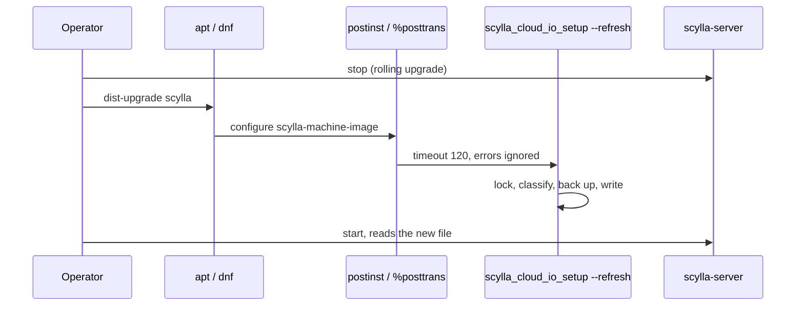
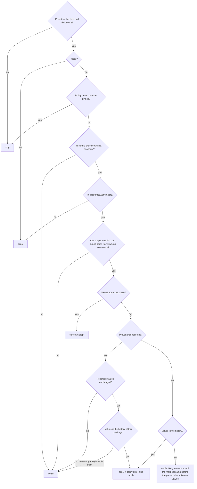

# Refresh `io_properties.yaml` during upgrade and boot

**Jira:** [SMI-218](https://scylladb.atlassian.net/browse/SMI-218) (from [#748](https://github.com/scylladb/scylla-machine-image/issues/748))

**Status:** draft

This document has three parts: the intent (the problem), the spec (the
design), and the plan (the work). It follows the development flow of
scylla-cluster-tests (`docs/development-flow.md`) in one file.

---

# Part 1: Intent

## Problem

`scylla_image_setup` writes `/etc/scylla.d/io_properties.yaml` and
`/etc/scylla.d/io.conf` once, on the first boot. It never writes them again.
When we correct a preset in `common/<cloud>_io_params.yaml`, the nodes that
run already keep the old values for their full life. A package upgrade does
not change them.

The only fix today is `scylla_io_setup` on each node. It runs `iotune` for
minutes, and the operator must do it node by node. The presets exist to avoid
this.

Scylla reads the file only when it starts. The documented rolling upgrade
already stops Scylla, upgrades the packages, and starts Scylla again. A
correct file written in that window costs the operator nothing.

## Who it affects

- Operators of nodes launched from official images on AWS, GCP, Azure, and
  OCI, with a preset that changed after their first boot.
- The worst cases are the families named in SMI-218: i7ie, i7i, i8g, and
  i8ge.
- Release engineering: a preset fix reaches only new nodes.

## Evidence

- SMI-324: 2026.1 images store `i7ie.2xlarge` per disk and multiply it by 2
  disks. Every 2026.1 `i7ie.2xlarge` node holds double values:
  `read_iops 432946`, `read_bandwidth 4000089600`, `write_iops 346960`,
  `write_bandwidth 2000141952`. The current preset is `216617`,
  `2000095104`, `173259`, `1000054656`.
- branch-2025.1 shipped `i7ie.2xlarge` as a per-disk entry that nodes
  multiply again. Those nodes hold 4 times the value.
- Before their families had a preset, i7ie nodes got a login banner that told
  the operator to run `scylla_io_setup`. Those nodes hold one `iotune` run.
- `debian/control` has `Depends: scylla` with no version. The RPM has
  `Requires: scylla = %{version}`.

## Definition of done

- A node whose file came from our presets gets the current preset during the
  documented rolling upgrade. The upgrade guide gets no new step.
- A node that missed the package hook gets the current preset at its next
  boot, before `scylla-server` starts.
- A file that we cannot prove we wrote stays as it is. The node gets the
  preset as a candidate file and one notice with one command.
- Each automatic change is in the journal, keeps a backup, and one command
  reverts it.
- An operator can turn the refresh off for one node or for a fleet, before
  the first upgrade that carries it.
- A refresh never runs `iotune`, never restarts Scylla, never fails a package
  transaction, and never stops `scylla-server` from starting.
- A change to a preset value cannot merge without the history that lets
  older nodes match it. CI enforces this.
- All four clouds, and the deb and rpm packages.

## Out of scope

- Instance resize on local-NVMe shapes. The resize wipes the disks and the
  first-boot marker stays, so RAID is not created again. This is a separate
  bug. The refresh does nothing when the data disk is not mounted.
- Running `iotune` again on the refresh path.
- A change to the documented upgrade procedure.

---

# Part 2: Spec

## Overview

The package ships the presets and a history of every value that any release
of this repository and of scylla-enterprise-machine-image wrote. One
operation, `scylla_cloud_io_setup --refresh`, computes the preset for the
node, classifies the file on the node, and writes the preset only when the
file is ours. The deb `postinst`, the rpm `%posttrans`, and each boot run
that operation. A file that is not ours stays, and the node gets a candidate
file and a login notice.

## Constraints

- The refresh is a table lookup. It takes less than one second.
- The refresh reads only the instance metadata that the first boot reads
  already. It calls no other cloud API.
- The package hooks do nothing before the first boot ends: not in an image
  build, and not in a container.
- `io_properties.yaml` and `io.conf` are one pair. The refresh changes both
  or neither.
- First-boot behavior does not change.

## Design

| Component | Role |
|---|---|
| `scylla_cloud_io_setup` | Computes the preset of the node (per cloud), and is the CLI of the refresh |
| `lib/io_refresh` | Classifies the pair, then writes, backs up, rolls back, or pins it |
| `common/<cloud>_io_params_history.yaml` | Every value set that a release wrote, by lookup key, and the date each key was first published |
| `tools/gen_io_params_history.py` | Generates the history from git: HEAD, every release branch, and the enterprise repository |
| deb `postinst`, rpm `%posttrans` | Run the refresh after a package upgrade |
| `scylla_image_setup` | Runs the refresh on each boot after the first |
| `scylla_configure.py` | Writes the policy file from user-data on the first boot |
| `scylla_login` | Shows the notice |

### Upgrade flow



On a node that missed the hook, `scylla-image-setup.service` runs the same
refresh at boot. It is ordered before `scylla-server`.

### Classification

The rules apply in this order. The first rule that matches decides.



- `apply`: copy each file of the pair to `.bak`, write the pair and the
  provenance, log when the change takes effect.
- `adopt`: the values are current and have no provenance. Write the
  provenance only.
- `notify`: write the preset to `io_properties.yaml.new` and write the
  notice. Change nothing else.
- The comparison uses values, not bytes. A different `yaml.dump` format on
  another distribution is not an edit.
- `yaml.dump` never writes comments. A comment line means a person edited
  the file.
- "Before the preset" compares the first-boot date with the date of the
  most specific key that has one. A GCP or Azure `*/<disks>` wildcard dates
  the disk-count rule, not the instance type. The rule changes only the
  reason in the notice.

### History lookup keys

| Cloud | Keys, in order |
|---|---|
| AWS | `<type>` |
| GCP | `<type>/<disks>`, `<type>`, `*/<disks>` |
| Azure | `<type>`, `*/<disks>` (the presets before the table were by disk count) |
| OCI | `<type>-<ocpus>` for Flex shapes, `<type>` |

The history holds rendered values: the values that a node file holds. The
generator runs each version of the table with the generator of that
version, for each disk count that the shape has. Presets that were in code
before the tables come from running each old generator with the instance
stubbed.

### Failure behavior

| Condition | Behavior |
|---|---|
| The node has no preset | Skip. Never run `iotune` |
| The data disk is not mounted, or the instance is not supported | Skip, exit 0 |
| Another refresh, rollback, or pin holds the lock | Wait. The caller time limit (120 s) ends the wait |
| The refresh fails or times out in a package hook | Log it. The package transaction succeeds |
| The refresh fails or times out at boot | Log it. `scylla-image-setup.service` succeeds and Scylla starts |
| The process stops between the two writes | Each file is written with an atomic rename. `io.conf` holds one fixed line, so the pair stays valid. The next run finds the current values and records the provenance |
| `--rollback` with no `.bak` | Error, change nothing |

## Contracts

### Configuration

The refresh policy. The first boot copies the user-data key to the policy
file. On a running node the file is the setting. An operator can write the
file before the upgrade that brings the refresh.

```yaml
# user-data (scylla_configure.py)
io_properties_refresh: auto   # auto | notify | never, default auto
```

```
/etc/scylla/io_properties_refresh_policy   # one word: auto, notify, or never
```

### Inputs

- Instance metadata that the first boot reads already: the instance type,
  the NVMe disk count, and the OCPU count on OCI.
- `/etc/scylla.d/io_properties.yaml` and `/etc/scylla.d/io.conf`.
- The mtime of `/etc/scylla/machine_image_configured`, as the first-boot
  date.
- `/opt/scylladb/scylla-machine-image/<cloud>_io_params_history.yaml`:

```yaml
first_published:
  i7ie.2xlarge: '2025-01-06'
published:
  i7ie.2xlarge:                                 # read_iops, read_bandwidth, write_iops, write_bandwidth
  - [432946, 4000089600, 346960, 2000141952]    # 2026.1, doubled (SMI-324)
  - [865892, 8000179200, 693920, 4000283904]    # 2025.1, 4 times
  - [216617, 2000095104, 173259, 1000054656]    # current
  # ... every other value set, from each release
```

### Outputs

```
/etc/scylla.d/io_properties.yaml(.bak|.new)
/etc/scylla.d/io.conf(.bak)
/etc/scylla/io_properties_notice            # shown by scylla_login
/etc/scylla/io_properties_provenance.yaml
```

```yaml
# io_properties_provenance.yaml
cloud: aws
keys: [i7ie.2xlarge]
values: [216617, 2000095104, 173259, 1000054656]
written_at: '2026-11-10T09:31:49+00:00'
pinned: false
```

The image build removes the provenance, the notice, the policy, and the
`.bak` and `.new` files. An instance from the image does not look managed by
the values of the builder.

The CLI:

```
scylla_cloud_io_setup --status              # what --refresh would do, change nothing
scylla_cloud_io_setup --refresh [--force]   # --force replaces a file that is not ours
scylla_cloud_io_setup --rollback            # restore the pair from .bak, and pin
scylla_cloud_io_setup --pin | --unpin       # keep the current file / refresh again
```

The Debian package:

```
Depends: scylla (>= V), scylla (<< V.0), ...
```

### Module API

```python
# lib/io_refresh.py
def classify(*, preset, yaml_text, conf_text, provenance, history, keys,
             first_boot, policy, force=False) -> Decision: ...   # pure
def refresh(*, preset, cloud, keys, force=False, dry_run=False) -> Decision: ...
def rollback() -> None: ...
def set_pinned(pinned: bool) -> None: ...
def save(params, *, cloud, keys) -> None: ...   # also used on the first boot

@dataclass
class Decision:
    action: str   # apply | adopt | current | notify | skip
    reason: str

# common/scylla_cloud_io_setup, one subclass per cloud
class CloudIoSetup:
    def compute(self) -> dict | None: ...       # the preset, or None
    def history_keys(self) -> list[str]: ...
```

## Risks

| Risk | Response |
|---|---|
| We overwrite a node that a person tuned | Only files that we recorded or whose four values match a published preset. All else gets a notice. `.bak`, `--rollback`, `--pin`, and the `never` policy |
| A new preset is wrong | Each table change is reviewed. CI requires its history. `.bak` keeps the old values on the node |
| A package downgrade writes older values over newer ones | The downgrade rule comes before the update rule: the recorded values are not in the history of the older package, so it notifies |
| The package hook breaks an upgrade | Time limit, errors ignored. The next boot does the same work |
| An image bakes the provenance of the builder | The image build removes it |
| Nodes of one cluster have different values during the rolling upgrade | Expected for the length of the upgrade. Not prevented |
| A family leaves the tables | No preset, so skip. The file stays |
| `apt-get install scylla` leaves `scylla-machine-image` old | The Debian package now requires its Scylla version. The documented `dist-upgrade scylla` upgrades all packages already |
| The operator does not restart Scylla | The journal and the notice say that the change takes effect when `scylla-server` starts |

## Deferred work

- Overrides: a reviewed exception that updates the nodes of a family whose
  first boot came before its preset. Add one to the history format and to
  the classification when a family needs it.
- More than one generation of backups.
- Plausibility limits on new values.
- The instance resize bug.

## Decisions

- The Debian package requires `scylla (>= V), scylla (<< V.0)`. An exact `(= ${binary:Version})` never matches, because scylla-pkg builds `scylla` and `scylla-machine-image` with different release strings. (build)
- No change in scylladb. `apt-get dist-upgrade scylla` upgrades every upgradable package, so it upgrades this one. (build)
- A file with four values equal to a published preset is ours, with no provenance. A person who types the exact preset values gets that preset again, with a `.bak`. (spec)
- The history covers every release branch of this repository and of scylla-enterprise-machine-image (2022.1 to 2024.2), so nodes from those releases update automatically. (review)
- Nodes whose first boot came before the preset of their key get a notice, not an update. No override, i7ie included. (review)
- The override code is removed until a family needs one. The "before the preset" date comes from the most specific key, because the `*/<disks>` wildcard dates hid the instance type date on GCP and Azure. (review)
- The downgrade of the SCT rolling upgrade covers the downgrade path. No separate downgrade test. (review)
- The default policy is `auto`. (review)
- The policy is set in user-data at launch and in a file on the node. The README documents it. The scylladb launch docs link to the README. (review)
- The policy and the triggers ship in the same pull request. An operator can turn the refresh off before it first runs. (review)
- OCI history keys hold the OCPU count, as the OCI table does. (review)
- The boot refresh and the package hooks run with a 120 s time limit and ignore errors. The lock has no time limit of its own. (review)
- A rollback pins the node, so the next boot does not apply the reverted preset again. (spec)
- `io.conf` that differs from our line makes the pair the user's. (spec)
- Backport to 2026.1, 2026.3, and 2026.4, after #1054. 2026.2 is at its end. The history is generated on `next` and copied unchanged. (review)

---

# Part 3: Plan

## Rules

- Unit tests run with `uv run pytest tests/`. Lint with `uv run ruff check`.
- Each task is one commit. Tasks 1 to 3 are one pull request, #1081, so the
  policy ships with the triggers.
- A decision during the build that changes Part 2 updates it in the same
  commit, with a line in `Decisions`.
- Real-instance tests reuse the existing Jenkins jobs, with the branch as a
  parameter.

## Task 1: Lock the Debian package to its Scylla version

**Files:**
- Modify: `dist/debian/control.template`, `dist/debian/debian_files_gen.py`

- [x] Check the range with `dpkg --compare-versions` for GA and rc versions.
- [x] Commit `7c7071a`.

## Task 2: Classification and history

**Files:**
- Create: `lib/io_refresh.py`, `tools/gen_io_params_history.py`,
  `common/{aws,gcp,azure,oci}_io_params_history.yaml`
- Test: `tests/test_io_refresh.py`

- [x] Test each row of the classification, with files from 2025.1 (4 times
  the value), 2025.3 only, Enterprise 2024.1 code presets, an Azure
  disk-count preset, and GCP disk-count presets.
- [x] Test that each current preset is in the history (CI gate).
- [x] Commit `0a3516d`.

## Task 3: CLI, triggers, policy, and docs

**Files:**
- Modify: `common/scylla_cloud_io_setup` (`CloudIoSetup` and the per-cloud
  `history_keys`), `common/scylla_image_setup` (`refresh_io_properties`),
  `common/scylla_configure.py` (`set_io_properties_refresh_policy`),
  `common/scylla_login`, `packer/scylla_install_image`,
  `dist/debian/debian/scylla-machine-image.postinst`, `dist/debian/debian/rules`,
  `dist/redhat/scylla-machine-image.spec`, `README.md`
- Test: `tests/test_io_refresh.py`, `tests/test_gcp_instance.py`

- [x] Test backup, rollback, pin, the lock, a boot failure that does not
  fail setup, and the policy from user-data.
- [x] README: the policy, the commands, and a checklist for adding or
  changing a preset.
- [x] Commit `f4aea1f`.

## Task 4: Real-instance tests

- [x] Images for all four clouds from the branch: BYO
  [#4516](https://jenkins.scylladb.com/job/scylla-master/job/byo/job/byo_build_tests_dtest/4516/)
  (AMI, GCE, OCI) and
  [#4521](https://jenkins.scylladb.com/job/scylla-master/job/byo/job/byo_build_tests_dtest/4521/)
  (Azure).
- [x] SCT rolling upgrade from the 2026.1 AMI, 3 × `i7ie.2xlarge`:
  [rolling-upgrade-ami-test #373](https://jenkins.scylladb.com/job/scylla-master/job/rolling-upgrade/job/rolling-upgrade-ami-test/373/).
  Each node got the current preset during `dist-upgrade`.
- [x] Downgrade: in #373 one node was upgraded, rolled back to 2026.1, and
  upgraded again. Both package transactions passed with the Debian lock,
  and the second upgrade found the file current. A downgrade between two
  versions that both have the refresh (expect a notice) is unit-tested.
  The same job covers it once two releases carry the refresh.

## Task 5: Backports

- [ ] Backport #1054 and then #1081 to 2026.1, 2026.3, and 2026.4.
- [ ] Set `**Status:**` to `built` when #1081 merges.
